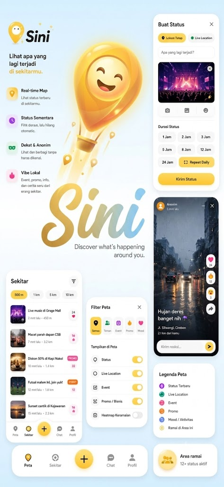

# Sini - Local Information Sharing App

Welcome to Sini, a mobile application designed to connect you with the community and information around your location. Discover events, share moments, and stay connected with what's happening in your neighborhood.

## Application Preview

<p align="center">
  
</p>

## About The App

Sini is a location-based social platform that aims to build stronger local communities. Users can easily see what's trending around them, from new dining spots and community events to important alerts from neighbors. With an intuitive interface and multi-language support, Sini makes it easy for everyone to participate.

## Key Features

- **Home:** View the latest posts from people around you in a dynamic feed.
- **Nearby:** Explore an interactive map to find posts, places, or events based on their geographical location.
- **Create Post:** Easily share your own information, photos, or events with the local community.
- **Chat:** Communicate privately with other users.
- **Profile & Settings:** Manage your profile, view your post history, and customize application settings, including language preferences (Indonesian & English).

## How to Run The Project

This project is built with React Native using Expo. To run it locally, follow these steps:

1.  **Clone the Repository**
    ```bash
    git clone <YOUR_REPOSITORY_URL>
    cd Sini
    ```

2.  **Install Dependencies**
    ```bash
    npm install
    # or if you use yarn
    # yarn install
    ```

3.  **Run the Application**
    ```bash
    npx expo start
    ```
    Then, scan the QR code that appears using the Expo Go app on your mobile device.